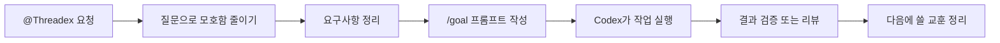

<div align="center">
  

  <h1>Threadex</h1>

  <p><strong>Codex에게 일을 맡기기 전에 요청을 또렷하게 정리해주는 도구</strong></p>

  <p>
    <a href="#0-threadex가-뭔가요"><strong>간단한 설명</strong></a>
    ·
    <a href="#1-threadex-설치하기"><strong>설치</strong></a>
    ·
    <a href="#2-subagents-설치하기-선택"><strong>Subagents</strong></a>
    ·
    <a href="#3-어떻게-돌아가나요"><strong>구조</strong></a>
    ·
    <a href="#4-어떻게-쓰나요"><strong>사용법</strong></a>
  </p>

  <p>
    
    
    
  </p>
</div>

---

## 0. Threadex가 뭔가요?

Threadex는 Codex에게 바로 “구현해줘”라고 맡기기 전에, 요청을 더 안전하게 정리해주는 Codex plugin입니다.

예를 들어 “설정 화면에 다크 모드를 넣어줘”처럼 조금 막연한 요청이 있을 때, Threadex는 먼저 빠진 조건을 확인하고, 요구사항을 정리하고, Codex의 `/goal`에 넣기 좋은 목표 문장으로 바꿔줍니다.

| 이런 상황에서 | Threadex가 도와주는 일 |
| --- | --- |
| 요청이 애매함 | 필요한 질문을 하나씩 정리 |
| 무엇을 만들지 기준이 없음 | 확인 가능한 요구사항 작성 |
| Codex `/goal`에 넣을 말이 길거나 어수선함 | 성공 기준과 경계가 분명한 목표 프롬프트 작성 |
| 정말 끝났는지 모르겠음 | 파일, 테스트, 결과 근거로 확인 |
| 다음 작업에도 배움을 남기고 싶음 | 재사용할 교훈 정리 |

> [!IMPORTANT]
> Threadex plugin 설치와 subagents 설치는 별도입니다.
> 처음 사용하는 경우에는 **1번 설치만 먼저 해도 됩니다.**
> 더 세밀한 검토 역할까지 쓰고 싶을 때만 2번 subagents 설치를 추가로 진행하세요.

## 1. Threadex 설치하기

ChatGPT 데스크톱 앱의 Codex에서 Threadex를 쓰려면 먼저 Threadex Marketplace를 추가하고, 그 안에서 Threadex plugin을 설치합니다.
여기서 Marketplace는 Codex plugin을 찾는 목록이라고 보면 됩니다.

1. ChatGPT 데스크톱 앱에서 Codex를 선택한 뒤 좌측 상단의 플러그인 tab을 엽니다.
2. `Built by OpenAI`라고 보이는 Marketplace 선택 버튼을 누릅니다.
3. 열린 목록 아래쪽의 `+ 더 추가`를 누릅니다.
4. `마켓플레이스 추가` 창에 아래 값을 그대로 넣습니다.

| 입력 칸 | 넣을 값 |
| --- | --- |
| 출처 | `https://github.com/jaehoonE7877/threadex` |
| Git ref | `main` |
| Sparse 경로 | `.agents/plugins`<br />`plugins/threadex` |

`Sparse 경로` 칸에는 아래처럼 두 줄로 넣으면 됩니다.

```txt
.agents/plugins
plugins/threadex
```

5. `마켓플레이스 추가`를 누릅니다.
6. Marketplace 목록에서 `Threadex`를 찾아 설치합니다.
7. 새 Codex 작업에서 `@Threadex`를 멘션해서 사용합니다.

터미널을 사용할 줄 안다면 아래 명령으로 Marketplace만 추가할 수도 있습니다.

```bash
codex plugin marketplace add https://github.com/jaehoonE7877/threadex \
  --ref main \
  --sparse .agents/plugins \
  --sparse plugins/threadex
```

## 2. Subagents 설치하기 (선택)

Subagents는 Codex 안에서 특정 역할을 맡는 보조 작업자입니다.
Threadex는 코드 탐색, 문서 확인, 검증, 리뷰 같은 역할을 위한 subagent 설정을 함께 제공합니다.

대부분의 사용자는 이 단계를 건너뛰어도 됩니다.
Threadex를 더 깊게 쓰고 싶을 때만 아래 단계를 진행하세요.

### 모든 Codex 작업에서 쓰기

터미널을 열고, Threadex 파일을 내려받은 폴더에서 아래 명령을 실행합니다.

```bash
mkdir -p ~/.codex/agents
cp plugins/threadex/codex/agents/*.toml ~/.codex/agents/
```

### 이 repo 안에서만 쓰기

```bash
mkdir -p .codex/agents
cp plugins/threadex/codex/agents/*.toml .codex/agents/
```

복사한 뒤 Codex를 재시작하거나 새 작업을 시작하세요.
그 다음 Codex에게 `code-explorer` 같은 Threadex subagent를 실행하도록 요청하고, `/subagents`에서 생성된 subagent 작업을 확인하면 됩니다.

## 3. 어떻게 돌아가나요?

Threadex의 기본 흐름은 아래와 같습니다.



| 단계 | 하는 일 | 결과 |
| --- | --- | --- |
| 1 | 빠진 조건을 질문으로 확인 | 더 명확한 요청 |
| 2 | 구현 전에 기준 정리 | 요구사항 |
| 3 | Codex `/goal`에 넣을 문장 작성 | 목표 프롬프트 |
| 4 | Codex가 작업 실행 | 구현 결과 |
| 5 | 결과가 맞는지 확인 | PASS(통과) / FAIL(실패) / BLOCKED(막힘) |
| 6 | 다음 작업에 쓸 점 정리 | 배운 점 |

Threadex는 결과와 완료 근거를 먼저 정의합니다. 여섯 단계를 항상 순서대로 실행하지 않고, 요청에 필요한 단계만 사용합니다. 이미 승인된 구현·수정은 단계가 바뀌어도 계속 진행하며, 근거가 부족한 상태를 완료로 처리하지 않습니다.

- “리뷰만 해줘”는 읽기 전용으로 끝납니다.
- “리뷰하고 고친 뒤 테스트해줘”는 문제 확인 → 수정 → 관련 검증까지 이어집니다.
- “검증하고 실패하면 고쳐줘”는 초기 판정 → 수정 → 재검증까지 이어집니다.
- “요구사항 정리 후 구현해줘”는 수용 기준을 정리한 뒤 구현과 검증을 계속합니다.
- “`/goal` 프롬프트만 작성해줘”는 초안만 반환하며 목표를 실행하지 않습니다.

Subagent 설정은 모델과 추론 강도를 고정하지 않습니다. Codex의 명시적 실행 설정, `[agents]` 기본값, 부모 설정의 우선순위를 따릅니다. 특정 모델을 쓰려면 사용자 환경에서 선택하세요. 자세한 상속 규칙은 [공식 Subagents 가이드](https://learn.chatgpt.com/docs/agent-configuration/subagents)를 참고하세요.

Threadex의 리뷰·검증 에이전트는 파일을 수정하지 않도록 지시받지만, 별도 읽기 전용 sandbox를 갖지는 않습니다. 실제 권한은 부모 세션에서 상속됩니다. 전용 에이전트가 없으면 사용 가능한 역할 또는 직접 확인으로 작업을 계속합니다.

### 메인 에이전트와 위임의 기준

기존 6개 스킬과 5개 subagent를 유지하며, 메인 에이전트가 사용자 결정과 전체 작업 맥락을 이어갑니다. 필요한 스킬만 읽고, 작은 조회는 직접 처리합니다. 독립 조사·병렬 작업·많은 자료의 분리가 맥락 전달과 결과 통합 비용보다 유리할 때 위임합니다.

실제 영향이 큰 변경, 복잡하게 상호작용하는 계약, 핵심 근거의 불확실성에는 독립 검토가 필요합니다. 파일 수나 업무 이름만으로 결정하지 않습니다. `gap-auditor`는 인계의 충분성, `code-reviewer`는 결함, `verifier`는 완료 주장을 확인하며, 이미 충분히 확인된 범위를 반복 검토하지 않습니다.

위임할 때는 확정한 사용자 결정·정확한 조건·허용 범위·대상 버전과 필요한 근거를 전달합니다. 반환된 근거가 현재 대상에도 적용되면 재사용하고, 코드·요구사항·환경이 바뀌거나 근거가 충돌한 부분은 다시 확인합니다. 독립 검토자는 핵심 원자료를 직접 확인하고, 메인이 결과를 통합해 남은 작업을 완료합니다.

전용 역할이 없으면 같은 범위의 새 에이전트를 사용할 수 있습니다. 독립 컨텍스트 자체를 사용할 수 없다면 안전한 범위의 작업은 계속하되 빠진 독립 검토를 알립니다. 직접 검증한 결과를 독립 검토로 표시하거나 필수 검토를 완료로 간주하지 않습니다.

세부 기준은 필요할 때 읽는 [맥락·위임·근거 재사용 지침](plugins/threadex/skills/verify/references/delegation.md)에 있습니다. 별도 실행 명령이나 필수 인계 문서를 추가하지 않으며, 초안·리뷰·검증만 요청한 경우 해당 범위를 지킵니다.

### 기존 설치 업데이트

```bash
codex plugin marketplace upgrade threadex
codex plugin add threadex@threadex
```

새 작업에서 갱신된 스킬을 사용하세요. 예전에 2번 절차로 subagent 파일을 복사했다면, plugin 업데이트와 별도로 해당 파일도 갱신해야 합니다. 직접 수정한 파일은 먼저 비교해 사용자 설정을 보존하세요. v0.5.0부터 배포본의 모델·추론 강도 고정과 효과가 없는 `sandbox_mode` 설정을 제거했습니다.

### 외부 요구사항과 검증 근거

티켓·디자인 명세·PR·CI처럼 저장소 밖에 필요한 근거가 있으면, 기존에 연결된 MCP나 plugin의 읽기 도구를 사용합니다. 로컬 근거가 충분한 작업에서는 외부 도구를 탐색하지 않습니다. 자체 MCP 서버나 필수 서비스 의존성을 추가하지 않습니다.

```text
@Threadex 이 티켓과 연결된 디자인 명세로 수용 기준을 정리해줘. 출처가 충돌하면 알려줘.
@Threadex 이 PR의 해당 커밋과 staging CI 결과를 기준으로 완료 여부를 검증해줘.
```

요구사항과 결과에는 필요한 출처 링크/ID, 버전·커밋·환경과 근거의 한계를 함께 남깁니다. 검색 요약, 티켓의 Done 상태, 다른 커밋의 CI 성공만으로 완료를 판정하지 않습니다. 접근 거부와 빈 검색 결과를 구분하며, 필수 근거가 빠졌다면 해당 항목을 `BLOCKED`로 표시합니다. 현재 로컬 자료로 확인할 수 있는 항목은 계속 검증합니다.

조회한 자료는 작업 지시나 쓰기 승인으로 취급하지 않습니다. 근거 수집만으로 티켓 상태 변경, 댓글 작성, 디자인 수정, CI 재실행을 수행하지 않습니다. 새 연결의 설치·인증·권한 변경도 자동으로 진행하지 않습니다.

자세한 기준은 필요할 때만 읽는 [공통 근거 수집 지침](plugins/threadex/skills/verify/references/connected_evidence.md)에 있습니다. 새 저장소나 원본 응답 덤프를 만들지 않고 기존 요구사항·검증 결과에 짧게 연결합니다.

### 배운 점은 어디에 저장되나요?

Threadex는 배운 점을 여러 곳에 흩어두지 않습니다.
AI가 읽는 파일은 한 폴더에 모으고, 사람이 읽는 문서는 따로 둡니다.

```text
.threadex/learnings/ledger.json
.threadex/learnings/index.json
docs/learnings/{YYYY-MM-DD}-{short-title}.md
```

| 위치 | 누가 읽나요? | 역할 |
| --- | --- | --- |
| `.threadex/learnings/ledger.json` | AI | 작업 중 나온 raw learning을 모두 모으는 원장 |
| `.threadex/learnings/index.json` | AI | 다음 `specify`가 빠르게 읽는 요약 색인 |
| `docs/learnings/*.md` | 사람 | `$threadex:compound`가 정리한 읽기 쉬운 장기 문서 |

`spec`이 있거나 PR, 브랜치, 요구사항 파일이 있어도 ledger 파일을 새로 나누지 않습니다.
대신 `ledger.json` 안의 `source` 필드로 어디서 나온 learning인지 기록합니다.
다음 `specify`는 먼저 `index.json`을 보고, 더 자세한 설명이 필요할 때만 연결된 `docs/learnings/*.md` 문서를 엽니다.
사람이 읽는 `docs/learnings` 문서 이름은 기본적으로 날짜와 짧은 제목을 쓰지만, repo에 이미 다른 파일명 규칙이 있으면 그 규칙을 먼저 따릅니다.

더 자세한 파일은 아래에서 볼 수 있습니다.

| 보고 싶은 것 | 위치 |
| --- | --- |
| Threadex plugin 전체 | [plugins/threadex](plugins/threadex) |
| Threadex 기능 목록 | [plugins/threadex/skills](plugins/threadex/skills) |
| Threadex subagents 설정 | [plugins/threadex/codex/agents](plugins/threadex/codex/agents) |
| 개발자용 테스트 안내 | [docs/smoke-testing.md](docs/smoke-testing.md) |

## 4. 어떻게 쓰나요?

새 Codex 작업에서 `@Threadex`를 부른 뒤, 원하는 일을 자연스럽게 말하면 됩니다.

```text
@Threadex 이 요청을 먼저 명확하게 정리해줘.
설정 화면에 다크 모드 토글을 추가하고 싶어.
```

요구사항을 만들고 싶다면 이렇게 말합니다.

```text
@Threadex 이 작업을 검증 가능한 요구사항으로 바꿔줘.
```

Codex `/goal`에 넣을 문장을 만들고 싶다면 이렇게 말합니다.

```text
@Threadex 이 요구사항을 Codex /goal 프롬프트로 정리해줘.
```

끝났는지 확인하고 싶다면 이렇게 말합니다.

```text
@Threadex 이 구현이 요구사항을 만족하는지 검증해줘.
```

Threadex 기능 이름을 직접 써도 됩니다.

| 이름 | 언제 쓰나요? |
| --- | --- |
| `$threadex:clarify` | 요청이 아직 애매할 때 |
| `$threadex:specify` | 요구사항을 정리하고 싶을 때 |
| `$threadex:goal-draft` | Codex `/goal`에 넣을 문장이 필요할 때 |
| `$threadex:verify` | 끝났다는 주장을 확인하고 싶을 때 |
| `$threadex:review` | 변경사항에 위험한 문제가 있는지 보고 싶을 때 |
| `$threadex:compound` | 이번 작업에서 배운 점을 남기고 싶을 때 |

Threadex의 제품 기준과 배포 기준은 이 GitHub repo에서 관리합니다.

- GitHub Canonical SSoT: https://github.com/jaehoonE7877/threadex
